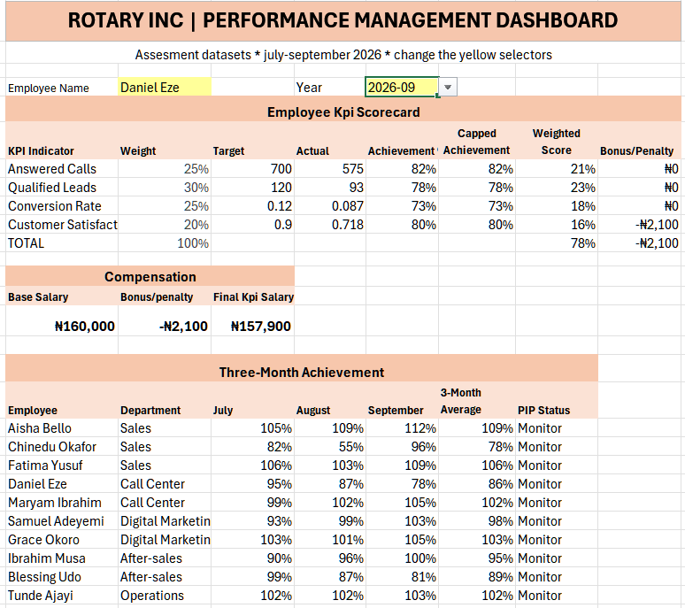

# EMPLOYEE KPI PERFORMANCE AND SALARY BONUS DASHBOARD W/ EXCEL

## Introduction
The Employee KPI Performance & Salary Bonus Dashboard is an Excel-based performance management and compensation analysis project developed to monitor employee productivity, evaluate KPI achievement, and calculate performance-based financial rewards.

The dashboard integrates employee information, KPI targets, actual performance results, weighted scores, bonus and penalty calculations, and three-month performance tracking.

It provides management with a structured approach to assessing employee contributions, identifying performance gaps, monitoring improvement, and supporting data-driven compensation decisions.

## Project objective
- Monitor employee performance against assigned KPI targets.
- Measure individual KPI achievement and weighted performance scores.
- Automate performance-based bonus and penalty calculations.
- Track employee performance across multiple months.
-Identify employees who meet targets and those requiring improvement.
- Provide management with a centralized view of employee performance and compensation.

## KPI Calculation Methodology

The workbook uses KPI weights and actual performance results to calculate employee performance.

### 📈Achievement Percentage

For higher-is-better KPIs:

Achievement = (Actual / Target) × 100

For lower-is-better KPIs:

Achievement = (Target / Actual) × 100

### 🔒Capped Achievement

Achievement is limited by the maximum performance cap defined in the KPI Master.

### ⚖️Weighted KPI Score

Weighted Score = Capped Achievement × KPI Weight

The KPI weight is converted to a decimal before multiplication.

### 🏆Total Employee KPI Score

Total KPI Score = Sum of Individual Weighted KPI Scores

### 💰Final KPI Salary

Final KPI Salary = Base Salary + Bonus/Penalty

The bonus and penalty calculations use the parameters defined in the KPI Master worksheet.

## Data Quality and Validation

The project incorporates data verification as part of the performance calculation process.

Features include:

- Employee and KPI reference data.
- Defined KPI data sources.
- Verified and review-required data statuses.
- Checks for invalid or non-positive target and actual values.
- Calculation controls that prevent unverified records from being treated as normal performance results.

The raw dataset includes a manual override review case to demonstrate how questionable performance records can be flagged for validation before being used in compensation calculations.

## Tools and Technologies

- Microsoft Excel
- Excel formulas and functions
- XLOOKUP and SUMIFS
- IF and IFERROR
- INDEX and MATCH
- Conditional formatting
- Data validation and dropdown selectors
- Automated KPI calculations
- Performance reporting and dashboard development

## Skills Showcased

### 📊 Data Analysis and Management

- Data cleaning and validation
- Data organization and structuring
- Performance data analysis
- Data quality monitoring

### 🔄 Excel and Automation

- Advanced Excel formulas
- Lookup and conditional functions
- Automated calculations
- Dynamic reporting
- Data validation and dropdown controls

### 🚀 Performance Management

- KPI design and structuring
- KPI weighting and target setting
- Employee performance evaluation
- Weighted performance scoring
- Performance monitoring
- Performance Improvement Plan tracking

### 💹 Financial Analysis

- Salary and compensation analysis
- Bonus and penalty calculations
- Performance-based incentive modelling
- Employee compensation reporting

### 📊 Business Intelligence and Reporting

- Interactive dashboard development
- KPI scorecard reporting
- Monthly performance comparison
- Management reporting
- Data-driven decision-making

 ## Conclusion

The Employee KPI Performance & Salary Bonus Dashboard demonstrates the application of Microsoft Excel in performance management, business analysis, and compensation modelling.

By integrating KPI evaluation, automated scoring, salary incentive calculations, and monthly performance monitoring, the project provides a practical example of how data analytics can support employee performance management and informed management decisions.